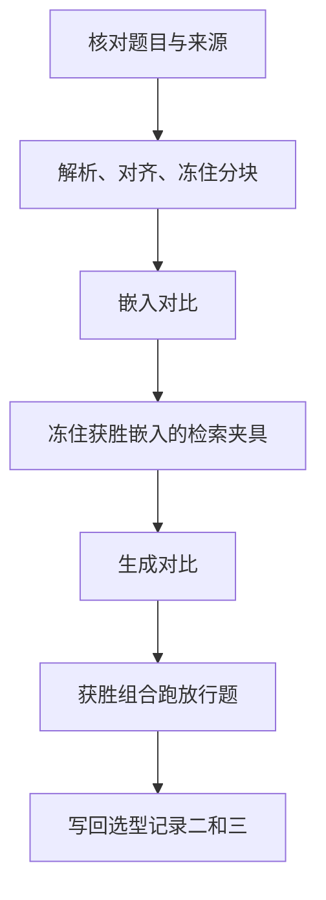

# 选型实验过程

日期：2026-10-18。决定嵌入模型和生成模型，对应 `design/06-architecture.md` 的选型记录二、三。存储、解析、应用栈已经决定，不在这次实验里重选。

2026-11-03：实验语料只用 `src-srd51-zh`。不测跨语言召回，不做英文第二条查询，版本对比题不进入夹具。下文若仍写英文原文、跨语言方向或版本对比，以本段为准。

完成后两处记录的状态改为「已决定」，并写上实测数据、模型全名、官网单价和许可证。`design/08-operations.md` 里的示意单价换成实测单价。

## 1. 完成标准

嵌入模型和生成模型各留下一个获胜者。获胜者同时满足：

- 日常题上的硬门槛（见第 6、7 节）；
- 与下一名的差距用配对自助法看过，打平的用耗时、内存、成本和许可证分出；
- 获胜组合在 20 道放行题上按同一门槛复核过一次；
- 复现该次结果所需的块清单、题目集版本、提示词版本和逐题得分都留在 `runs/` 里。

放行题只复核，不参与挑选，也不按放行结果回头改分块或提示词。

## 2. 实验原则

这些原则来自检索评估和 RAG 评估的公开做法，并按本项目的设计收窄。

| 原则 | 在本实验中的做法 | 依据 |
| --- | --- | --- |
| 用本项目的题做决定 | 用 `eval-v0.2` 的日常题。公开榜只用来剔除明显不能用的模型 | 自有标注集；MTEB / MIRACL 不能代替领域题。MIRACL 是同语言检索，不是中文问英文库 |
| 一次只换一个变量 | 嵌入对比冻住分块、距离和过滤；生成对比冻住检索结果和提示词 | 换库基准要求语料、向量、查询、距离、过滤同时固定 |
| 金标准标到条目 | 命中看权威 `entry_id`，不看块编号 | 与 `design/05-acceptance.md` 一致；改分块后标签仍有效 |
| 召回用实际送进模型的条数 | 门槛用前 5 条；同时记录当次装入的父节数和命中名次 | 装入预算见 `design/07-pipelines.md`，是实验旋钮，起点约为 2.5k token 的父节正文。名次另记 |
| 跨语言按方向切开 | 中文搜英文、英文搜中文、以及两个同语言方向分开报 | 多语言 RAG 按语言对切片，不把方向并成一个平均数 |
| 查询改写单独成列 | 直接跨语言、术语表双查询、对齐兜底三列都报。多查询、假设性文档嵌入和退步提示不进入本轮 | 查询改写是检索前的独立步骤，不能算进嵌入模型的成绩。这三种改写都要先调用生成模型，会把假设写进查询向量 |
| 小样本看区间 | 逐题保存 0/1，配对自助法 10,000 次、种子 42、95% 区间 | 大约 40 道证据题，一两道题的差距可能是噪声 |
| 能用代码判定的不用模型判 | 结构、引用范围、数值、版本用代码；「这句话是否被片段支持」才用裁判模型 | 裁判校准要求先有人工标签，并单独报告它抓失败的能力 |
| 留出集不参与挑选 | 20 道放行题在选出获胜组合之后跑一次 | 与题目集里「放行」的用途一致，也避免在公开题上调到过拟合 |

## 3. 总顺序

嵌入实验和裁判校准可以并行。生成实验等夹具写完再开始。

## 4. 开工前核对

`log/2026-10-16.md` 已完成原文核对：题目集为 `eval-v0.2`，R04、R05、V02、R20 的证据已写入 `design/05-acceptance.md`。C03 的 5.1 英文页码仍未钉死。

写「已决定」之前还要完成：

1. 问法已于 2026-10-24 由项目作者确认，版本保持 `eval-v0.2`。此后问法一改就升级题目集版本，已有得分不能跨版本比较。从条文措辞反推的问法会抬高召回。
2. 四种来源按 `design/07-pipelines.md` 解析、切条目、对齐。每种格式抽 20 条，标题、数值、表格、怪物属性块和法术头部通过人工核对。切分位置用该文档规定的 Chonkie Visualizer HTML 核对。
3. 按同一分块规则产出块清单并计算校验值。此后嵌入模型都用这一份。
4. 术语表里只有审核通过的词条可以进入「生产路径」。待审核的机译词不进入。

C03 的 5.1 侧不进入召回分母，5.2 侧照常计。页码钉死之后补测 5.1 侧。L05、V05 的中文 5.1 没有种族文件，这两题不进入「中文搜中文」的分母。

## 5. 固定下来的资产

这些文件是被第 1 节和第 10 节逼出来的。第 1 节要求复现该次结果所需的块清单、题目集版本、提示词版本和逐题得分都留在 `runs/` 里。第 10 节规定：块清单校验值、题目集版本、提示词或裁判提示词版本、距离、归一化或过滤条件变了，或者生成模型没有读同一份 `fixture.jsonl`，这次结果作废，另开 `run-id`。要判断这几件事有没有变，就必须把它们写成文件，不能只留在当次进程里。

拆成多份，是因为第 2 节要求一次只换一个变量，并且检索和生成分开打分。公开文献给出的是原则，不是这七个文件名；文件名按上面的作废条件拆开。依据见第 12 节。

每次运行建一个目录 `runs/<run-id>/`，`run-id` 用日期加序号，例如 `2026-10-20-01`。目录里放：

| 文件 | 内容 | 必须留下的原因 | 内容从哪来 |
| --- | --- | --- | --- |
| `manifest.md` | 题目集版本、块清单校验值、分词器名称、切开上限、装入预算、提示词版本、裁判提示词版本、模型全名、距离、k、种子、CPU 型号、日期 | 第 10 节要核对的版本、距离、归一化、过滤和种子都写在这里。换库基准要求语料、向量、查询、距离、过滤同时固定。分词器名称用来确认切开上限的计数没有换过 | 当次运行的配置，加上 `design/05-acceptance.md` 的题目集版本。开跑时写下，跑完补上实测模型名和耗时 |
| `chunks.jsonl` | 冻住的块。字段与 `design/07-pipelines.md` 的块元数据相同 | 嵌入对比必须冻住同一套分块。第 4 节第 3 步要求先算出校验值，此后所有嵌入模型都用这一份 | `design/07-pipelines.md` 的分块规则和块元数据。原始 SRD 只读，不在原地修改 |
| `queries.jsonl` | 日常题：编号、语言、版本意图、问题、权威 `entry_id` 列表、期望行为 | 用本项目的题做决定。金标准标到 `entry_id`，不标块编号。公开榜只用来剔除明显不能用的模型 | `design/05-acceptance.md` 的 `eval-v0.2` 日常题。放行题不进入这份挑选用的题 |
| `retrieval/` | 每个嵌入模型、每条检索路径的逐题结果 | 三条检索路径分开报。查询改写不算进嵌入模型的成绩。逐题 0/1 留给配对自助法 | 每个候选嵌入模型，对 `queries.jsonl` 在冻住的块上检索之后写出 |
| `fixture.jsonl` | 获胜嵌入在生产路径上、按当次装入档位送进模型的父节，含中英原文 | 生成对比必须冻住检索结果。没读同一份夹具的生成结果作废 | 只从获胜嵌入的生产路径里抽，并按 `entry_id` 附上中英原文 |
| `generations/` | 每个生成模型的原始输出、token 数、耗时 | 引用支持、拒答、token 和耗时按模型保留原始输出，方便重算，也方便裁判校准 | 各生成模型读同一份 `fixture.jsonl` 和同一版提示词之后的接口返回 |
| `scores/` | 逐题 0/1 和汇总 | 约 40 道证据题不能只看一个平均分。逐题 0/1 才能做 10,000 次配对自助法 | 用代码和已校准的裁判，对 `generations/` 与 `queries.jsonl` 的期望逐题判定 |

写出顺序与第 3 节相同：核对题目和来源之后，解析、对齐、冻住分块，得到 `chunks.jsonl` 和 `queries.jsonl`；嵌入对比写出 `retrieval/`；获胜嵌入再冻成 `fixture.jsonl`；生成对比写出 `generations/` 和 `scores/`。

密钥放在环境变量或 `.env`，不写入这些文件。原始 SRD 不在原地修改。

检索共用的设置：

- 全库，大约一万到两万块。不用样本库。
- 距离用余弦。向量先做 L2 归一化。
- 精确搜索。两万条向量足够，近似索引的误差不混进模型比较。
- 过滤在搜索时生效：单版本题按 `rule_version`；「两版」对 5.1 和 5.2 各搜一次；来源状态为可用。
- 版本意图用 `design/04-answer-contract.md` 的关键词表，不用模型改写。

## 6. 嵌入模型

### 6.1 候选

只比较 API，不比较本地模型。实验当天到官网核对全名、维度、最大长度、许可证和价格。下表是 2026-10-18 检索后的起点，单价以当天页面为准。

| 候选 | 角色 | 约束 |
| --- | --- | --- |
| `qwen3.7-text-embedding` | 中英主候选 | 上下文 128,000 token。维度用 1,024。单价约 0.0005 元/千 token。香港地域若没有该模型名，改用新加坡地域，或退到香港已有的 `text-embedding-v4` |
| `voyage-4-large` | 海外多语言上限 | 上下文 32,000 token。维度用默认 1,024。文档和查询分别使用厂商规定的 document / query 输入类型。每账号前 2 亿 token 免费 |
| `text-embedding-3-large` | 非英语对照 | 上下文 8,192 token，高于块长。维度用默认 3,072，不缩短。官方返回已归一化 |

三家都用厂商文档里的检索用法，并写入 `manifest.md`。返回向量未做 L2 归一化时，入库前先归一化。许可证不允许本项目使用的模型，不嵌入全库。

2026-11-05：本轮对照不使用 `voyage-4-large` 和 `text-embedding-3-large`。第二家改为智谱 `embedding-3`。维度用官方默认 2048，不缩短到 1024。接口是 `POST https://open.bigmodel.cn/api/paas/v4/embeddings`，模型名 `embedding-3`。官网单价 0.5 元/百万 tokens。接口说明写单条最多 3072 tokens，模型页概览又写上下文 8K。超过接口上限的块不截断，截断比例另计。重排仍用已经测过的 `qwen3.7-text-rerank`，只换嵌入模型。索引单独存放，不覆盖千问那一份。

切开上限见 `design/07-pipelines.md`，实验比较 512 和 1024 token，不预设 800。模型最大长度低于块长时，记下截断比例。这种召回上限来自截断，比较时单列。同一家的降本型号（如 `qwen3.7-text-embedding-flash`、`text-embedding-3-small`）不进本轮；主候选都不过线时再加。Jina `jina-embeddings-v5-text-small` 的权重是 CC-BY-NC-4.0，实验当天核对 API 条款，不允许公开试用就不加入。

### 6.2 三条检索路径

每条路径都用同一套块和同一批查询。

1. **直接跨语言。** 中文题只搜 `lang=en` 的块，英文题只搜 `lang=zh` 的块。这列衡量嵌入模型本身。
2. **生产路径。** 中文题用术语表再生成一条英文查询，英文题反过来。两条结果按 `entry_id` 合并，两种语言的块都可命中。这列对应上线检索。
3. **对齐兜底。** 在生产路径上，中文块命中后，用该块的 `entry_id` 取英文原文。这列对应设计里的退路：跨语言不够时，仍可按条目编号取回权威原文。

同语言两列（中文搜中文、英文搜英文）一并算出，只作诊断，不单独设门槛。

### 6.3 计分

权威证据取 `design/05-acceptance.md` 里分号前的来源和条目。译文单独出现不算命中。

一道题算召回，当且仅当它的每一条权威证据都出现在对应检索的前 5 条里。多证据题（版本对比、V02）缺一条即该题未召回。另报证据级召回：命中证据数除以应命中证据数。

前 8 条用同一规则再算一列。两列选出的模型不同时，写入选型记录，门槛仍以前 5 条为准。

计分题：日常集里有权威证据的 L、M、C、V、R，去掉 P 类，并去掉第 4 节排除的侧面。约 40 题。R 类里没有标准证据的题不进召回分母。

方向切片至少包括：中文题搜英文库、英文题搜中文库。切片样本更小，只解释差距来自哪，不另设 90% 门槛。

### 6.4 耗时和价格

查询耗时：同一网络、批大小 1、预热之后，用日常题的问题文本各请求一次。报 P50 和 P95。这是接口往返时间，不记服务器 CPU。全量嵌入的耗时只作记录。

同时记录：向量维度、最大长度、截断的块数、官网单价。单价以人民币记；外币按实验当天汇率折算，汇率写进 `manifest.md`。服务器不常驻嵌入模型。

### 6.5 比较和决定

逐题保存是否命中。两个模型的差用配对自助法：按题目编号重抽样 10,000 次，种子 42，取 95% 区间。区间包含 0 视为打平。

决定顺序：

1. 生产路径、前 5 条、题目级召回 ≥ 90%。
2. 过线的模型里，直接跨语言（中文搜英文）的配对区间不包含 0 时，取得分高的。
3. 仍然打平时，依次比较接口 P95、单次查询价格、是否截断、许可证。

没有任何模型达到 90% 时，不降低门槛。把三列召回和失败题目写入记录，退回分块或对齐，不进入生成实验。

## 7. 生成模型

### 7.1 候选

每天模型费用上限约 21 元。示意单价下，低价模型每天约 1,200 题，高价模型约 120 题。先比三家低价模型。三家都过不了硬门槛时，再加一家旗舰，并按官网单价重算每天可答量。

| 起点 | 用途 |
| --- | --- |
| DeepSeek 的低价型号 | 国内 API |
| 通义千问的低价型号 | 国内 API |
| 一家海外低价型号 | 看中文和拒答是否明显更好 |

实验当天核对模型全名、上下文长度和官网单价。单价以人民币记；外币按实验当天汇率折算，汇率写进 `manifest.md`。

2026-11-06：本轮只比两家低价模型，海外低价型号不加入。DeepSeek 用 `deepseek-flash`（DeepSeek-V4.1-Flash-1017，上下文 100 万）。千问用固定快照 `qwen3.7-flash-2026-07-15`，不用会随时间更换的 `qwen3.7-flash`。两家都关闭思考模式，温度取 0。DeepSeek 思考模式默认开启，且开启时温度不生效，请求里写 `thinking.type=disabled`。千问用非思考模式。`deepseek-v4-pro` 与 `qwen3.7-plus` 仍是旗舰，两家低价都过不了硬门槛时才加。

当天官网原价，单位是元/百万 tokens。`deepseek-flash` 缓存未命中：空闲时段输入 1、输出 4，高峰时段输入 2、输出 8。高峰是北京时间周一至周五 9:00–12:00 与 14:00–18:00，不含法定节假日。`qwen3.7-flash-2026-07-15` 在华北2（北京）、单次输入不超过 3.2 万 token 时，输入 0.2、输出 0.8。父节装入在这个范围里。

### 7.2 夹具和提示词

用获胜嵌入的生产路径，把全部日常题按当次装入档位送进模型的父节存进 `fixture.jsonl`，并按 `entry_id` 附上英文原文和中文译文。版本对比题两侧都在夹具里。各生成模型读这一份。

提示词只有一版，实现 `design/04-answer-contract.md`：

- 开头标明版本；
- 类型为回答或拒答，拒答带类别；
- 句子列表，每句带 `entry_id`；
- 规则或数值必须出现在有引用的句子里。

温度取 0；厂商不支持时取允许的最低值，并在清单里写明。实验期间不按厂商改提示词。某个模型填不满结构时，所有模型都追加同一条格式说明，再请求一次，这次计入重试和成本。

P 类不进入第一期计分。多轮题本次不测，夹具里没有前几轮对话。

### 7.3 哪些题送到模型

R6、R8 在线上由关键词拦截，不调用模型。日常集中的 R14、R15、R18、R19 只跑一次拦截规则，确认被拦住。这四题不用来区分生成模型。

其余日常题都送到每个模型，包括应正常回答的题和 R1、R2、R3、R4、R5、R7。送到模型的拒答题约 10 道。

### 7.4 代码计分

下列各项用代码判定，同一套规则跑每个模型：

| 检查 | 判为失败 |
| --- | --- |
| 输出结构 | 缺类型、缺拒答类别，或句子没有规定的字段 |
| 引用范围 | 句中的 `entry_id` 不在该题夹具里 |
| 数值 | 句中的骰子表达式或数字在所引英文原文中找不到 |
| 版本 | 结论所标版本与引用条目的 `rule_version` 不一致 |
| 拒答类别 | 输出类别与题目的期望类别不一致 |
| 误拒 | L、M、C、V 被输出成拒答 |

版本混淆统计不一致的题数，门槛是 0。引用校验按线上规则失败后重生成一次，第二次仍失败则该题按证据不足计，重试的 token 计入成本。

### 7.5 裁判模型

裁判只判断一件事：有引用的句子，其说法是否被所引片段支持。输出先写理由，再给「支持」或「不支持」。裁判不使用正在比较的生成模型。温度取 0，提示词在看到本次生成结果之前写好，版本号写入清单。

项目作者先人工打 20 道日常题，覆盖正常回答、部分回答（R04、R05）、至少三类拒答和一道版本对比，其中包含应当判失败的例子。一致率按句子计，达到 90% 才用裁判给其余句子打分。同时看裁判对「不支持」的召回：该抓住的失败没抓住时，不用总一致率放行。

一致率低于 90% 时，换裁判或修改提示词，然后人工打完本次全部日常生成结果。选型不使用未校准的自动分。

引用支持率等于「判为支持的有引用句子数 / 有引用句子数」，分母按 `design/05-acceptance.md`，只含有标准证据的题。

### 7.6 成本、延迟和中文

单题成本用接口返回的输入、输出 token，乘以官网单价，含格式重试和引用校验重试。每天可答量用 21 元除以单题成本。

记两个时间：

- 接口首 token 时间；
- 第一句通过引用校验的时间。线上目标是后者的 P95 ≤ 2 秒。

本机到厂商的绝对时间只用于同一网络下的相对排序。2 秒门槛等服务器在香港或海外之后再确认。

中文表达不设数值门槛。硬门槛打成平局时，项目作者抽看同一批 10 道中文日常题。

### 7.7 决定

硬门槛，都在日常题上：

| 指标 | 门槛 |
| --- | --- |
| 引用支持率 | ≥ 95% |
| 正确拒答率 | ≥ 95%（只计送到模型的拒答题，类别必须正确） |
| 版本混淆 | 0 |
| 误拒率 | ≤ 5%，只观察，不淘汰模型 |

送到模型的拒答大约 10 道，错 1 道就是 90%。逐题列出对错。只有一个模型错的题，该模型不过门槛。所有模型错同一题时，先检查题目和提示词，不据此淘汰全部模型。

过了硬门槛之后，用配对自助法比较引用支持率。区间包含 0 时视为打平，取得单题成本更低、每天可答量更大的模型。成本仍打平时，用中文抽查和首句校验时间分出。

## 8. 放行复核

只把获胜嵌入和获胜生成模型配成一组，跑 `eval-v0.2` 的 20 道放行题。检索、提示词、裁判都与日常实验相同。R20 在这里检查现实政治拦截没有误伤阵营说明，它计入误拒，不计入正确拒答。

放行题未过门槛时，不改放行题、不按放行题调整提示词。回到日常集，只改一个变量，使用新的 `run-id`。

## 9. 写回

在 `design/06-architecture.md` 写明：

- 模型全名和版本、实验日期、`run-id`、题目集版本；
- 嵌入三列召回、前 8 条召回、接口 P95、官网单价、维度、截断、许可证；
- 生成模型的引用支持率、正确拒答率、版本混淆、误拒率、单题成本、每天可答量、官网单价；
- 与第二名的配对区间；打平时写明用哪一项分出；
- 放行复核的结果。

`design/08-operations.md` 的单价表改为实测值。嵌入走 API，服务器不为嵌入模型预留常驻内存。

## 10. 整次结果作废的情况

出现下列任一情况，保留原目录，另开 `run-id`，不把两次数字放进同一张决定表：

- 块清单校验值变了，或计数用的分词器变了；
- 题目集版本变了；
- 提示词或裁判提示词版本变了；
- 距离、归一化或过滤条件变了；
- 生成模型没有读同一份 `fixture.jsonl`。

## 11. 结果空白表

实验结束后填入获胜运行的数字。区间写成 `差值 [下限, 上限]`。

### 嵌入

| 模型 | 直接跨语言召回@5 | 生产路径召回@5 | 对齐兜底召回@5 | 召回@8 | 与对照的配对区间 | 接口 P95 | 单价 | 维度 | 截断块数 | 许可证 |
| --- | --- | --- | --- | --- | --- | --- | --- | --- | --- | --- |
| `qwen3.7-text-embedding` |  |  |  |  |  |  |  |  |  |  |
| `voyage-4-large` |  |  |  |  |  |  |  |  |  |  |
| `text-embedding-3-large` |  |  |  |  |  |  |  |  |  |  |

### 生成

| 模型 | 引用支持率 | 正确拒答率 | 版本混淆 | 误拒率 | 单题成本 | 每天可答量 | 首句校验 P95 | 与对照的配对区间 |
| --- | --- | --- | --- | --- | --- | --- | --- | --- |
| DeepSeek 低价型号 |  |  |  |  |  |  |  |  |
| 通义千问低价型号 |  |  |  |  |  |  |  |  |
| 海外低价型号 |  |  |  |  |  |  |  |  |

放行复核：召回 ____，引用支持 ____，正确拒答 ____，版本混淆 ____。

## 12. 参考

- NVIDIA，企业检索评估：召回与名次指标的适用场合。https://developer.nvidia.com/blog/evaluating-retriever-for-enterprise-grade-rag/
- 在自有数据上评估嵌入模型：50–200 道题、按实际上线的 k 计分，延迟和价格与召回同表。https://dreaming.press/posts/how-to-evaluate-an-embedding-model-on-your-own-data.html
- 换向量库时的召回基准：冻住语料和向量，精确搜索与语义相关分开。https://agentengineeringdigest.com/knowledge-base/foundations/how-to-benchmark-recall-accuracy-when-swapping-vector-databases/
- 多语言 RAG：按语言对切片。https://medium.com/data-science-at-microsoft/building-and-evaluating-multilingual-rag-systems-943c290ab711
- MIRACL：同语言检索基准，不用于本项目的跨语言决定。https://direct.mit.edu/tacl/article/doi/10.1162/tacl_a_00595/117438/MIRACL-A-Multilingual-Retrieval-Dataset-Covering
- RAG 评估综述：检索与生成分开。https://arxiv.org/html/2504.14891v1
- Evidently，RAG 评估指南。https://www.evidentlyai.com/llm-guide/rag-evaluation
- 配对自助法。https://pypi.org/project/paired-evalkit/
- LLM 裁判：二元结论、先写理由、用留出人工标签校准，并单独看失败样本。https://arize.com/guides/llm-as-a-judge/
- TREC 2024 RAG Track：引用支持上模型裁判与人工的一致程度。https://dl.acm.org/doi/10.1145/3726302.3730165
- RTEB：公开题之外保留私有题，避免只对榜单过拟合。https://huggingface.co/blog/rteb
