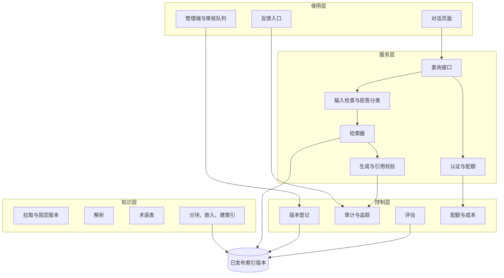

# 06 系统边界与选型记录

对应流程第 6 步「系统边界」。

## 边界图

系统分成四块，块与块之间只通过接口交流。

## 各块职责

| 块 | 职责 | 对外接口 | 不共享的内部状态 |
| --- | --- | --- | --- |
| 知识层 | 拉取中文 5.1、解析 Markdown、维护术语表、分块、嵌入、构建索引版本 | 产出一个待发布的索引版本；提供重建与删除命令 | 解析中间文件、构建中的索引 |
| 服务层 | 认证后的查询：输入检查、版本识别、检索、重排、生成、引用校验 | 网页查询、外部查询 API、反馈接口 | 单次请求的上下文、该对话的存档与会话卡片 |
| 控制层 | 登记版本、审计、评估、配额与成本 | 发布或回退版本、查询日志、运行评估 | 审计日志、评估结果、配额计数 |
| 使用层 | 对话页面、管理端、审核队列、反馈入口 | 只调用服务层和控制层的接口 | 前端会话状态 |

关键约束：服务层只读取「已发布」的索引版本，永远不读构建中的索引。发布和回退只是切换已发布版本的指针，由控制层完成。

## 在线路径

- **短路径（第一期）：** 输入检查、超出收录范围则拒答、带版本和来源过滤的向量检索、合并候选、重排、按实验档位装入父节、生成、引用校验。只检索中文 5.1。顺序和档位见 [07-pipelines.md](07-pipelines.md)。
- **长路径（再往后）：** 留给规则交互裁定这类需要多步检索的问题。第一期遇到这类问题时走短路径，并注明完整裁定需要 DM 判断。
- 检索层允许以后并行加入别的索引，例如第二期的关键词检索，第一版不预设是哪一种。

## 可替换点

| 可替换点 | 接口 | 第一期选择 | 替换时必须做的事 |
| --- | --- | --- | --- |
| 解析器 | 输入原始文件，输出条目列表 | MinerU（PDF）、HTML 解析（GBK 解码）、Markdown 解析 | 重新解析并重建索引；跑全部验收题 |
| 嵌入模型 | 输入文本，输出向量 | 待对比，见选型记录二 | 全量重新嵌入，不能只换查询侧 |
| 向量存储 | 写入块、按过滤条件检索 | PostgreSQL + pgvector | 迁移数据；跑全部验收题 |
| 生成模型 | 统一的对话补全接口 | `qwen3.7-flash-2026-07-15`，见选型记录三 | 跑全部验收题；更新成本估算 |
| 重排模型 | 输入候选块，输出排序 | 第一期必做；厂商待对比，见选型记录六 | 跑全部验收题；重标分数下限 |
| 查询改写 | 输入问题，输出一条或两条检索文本 | 第一期用术语表替换，检索前不调用生成模型 | 改写策略一变就新开运行编号，重跑召回 |
| 近似索引 | 同一套向量上的搜索实现 | 选型和第一期用精确搜索 | 召回达标后才能调近似索引参数；参数变化单独成一轮 |

## 选型记录

每条记录写明背景、候选、决定、验证方式和状态。

### 选型记录一：存储

- **背景：** 需要存放块、向量、条目结构化信息、账号与配额。数据量为一至两万个块，规模很小。
- **候选：** PostgreSQL + pgvector；Qdrant + PostgreSQL；OpenSearch。
- **比较方向：** 结构化查询、中文关键词检索、混合检索的融合方式、带过滤的向量检索、一致性与删除传播、运维成本。
- **决定：** PostgreSQL + pgvector。
- **理由：**
  - 第一期只用向量检索；
  - 条件筛选可以直接写 SQL；
  - 条目、块、向量、配额都在一个库里，删除和重建一个事务就能完成，满足 7 天下架时限；
  - 一台服务器上只多一个组件。
- **验证方式：** 第一期验收题的检索召回率 ≥ 90%。
- **遗留问题：** 第二期的关键词检索用验收题对比两条路线：PostgreSQL 加中文分词扩展（如 `zhparser` 或 `pg_jieba`），或者引入 Qdrant 的稀疏向量。召回不达标时再更换。
- **状态：** 已决定。2026-11-04 起，当前可运行的 RAG 主体在 `rag/`，沿用 All-in-RAG 第 8 章的四段流程：本地 FAISS、BM25 与倒数排名融合。嵌入和生成都调用 OpenAI 兼容的外部接口，模型名从环境变量读取，不在本机加载模型。语料是已经切好的中文 5.1 块。PostgreSQL + pgvector 仍是以后在线服务的存储。嵌入模型见选型记录二，生成模型见选型记录三。重排仍待对比。

### 选型记录二：嵌入模型

- **背景：** 语料和提问都是中文。只比较 API，服务器不常驻嵌入模型。
- **候选：** 本轮是 `qwen3.7-text-embedding`（已测，维度 1024）和智谱 `embedding-3`（官方默认维度 2048，不缩短）。`voyage-4-large` 与 `text-embedding-3-large` 不进入本轮。约定见 [../ModelSelectionExperiment/00-procedure.md](../ModelSelectionExperiment/00-procedure.md) 第 6.1 节。
- **比较方向：**
  - 生产路径的题目级召回；
  - 中文提问检索中文条目的召回；
  - 接口单条查询耗时；
  - 官网单价；
  - 许可证。
- **验证方式：** 同一套分块上按选型实验第 6 节比较。门槛是生产路径、前 5 条、题目级召回 ≥ 90%。
- **补充：** 命中后按 `entry_id` 取回中文原文，见 [07-pipelines.md](07-pipelines.md)。
- **状态：** 已决定。2026-11-05 选定智谱 `embedding-3`，维度 2048。两家日常题召回都是 12/12，权威条目都在第 1 名。单条查询 P95：`embedding-3` 293.6 ms，`qwen3.7-text-embedding` 1110.9 ms。官网单价都是 0.5 元/百万 tokens；按接口返回的 token，单次查询均价分别约 0.000007 元和 0.000013 元。两家截断块数都是 0。两家协议都允许付费接入自有应用。召回见 `runs/2026-11-05-02/`，耗时见 `runs/2026-11-05-03/`。重排仍用百炼的 `qwen3.7-text-rerank`，密钥与嵌入分开。

### 选型记录三：生成模型

- **背景：** 部署在香港或海外，国内和海外的模型 API 都可以调用。
- **候选：** 本轮是 `deepseek-flash`（DeepSeek-V4.1-Flash-1017）和 `qwen3.7-flash-2026-07-15`。两家都关闭思考模式，温度取 0。海外低价型号不进入本轮。`deepseek-v4-pro` 与 `qwen3.7-plus` 留到两家低价都过不了硬门槛时再加。单价和调用约定见 [../ModelSelectionExperiment/00-procedure.md](../ModelSelectionExperiment/00-procedure.md) 第 7.1 节。
- **比较方向：**
  - 引用支持率和正确拒答率；
  - 中文表达；
  - 首字响应时间（目标 ≤ 2 秒）；
  - 每题平均成本。
- **接口：** 在服务层内部定义统一的对话补全接口。每个厂商写一个适配器，模型编号和 API 密钥从环境变量读取。可以评估现成的统一网关库，但是否引入以适配器的代码量为准。
- **验证方式：** 同一套检索结果下，跑全部验收题对比各项指标。
- **决定：** `qwen3.7-flash-2026-07-15`。关闭思考，温度取 0。
- **状态：** 已决定。2026-11-06，运行 `runs/2026-11-06-02`，检索夹具沿用 `runs/2026-11-06-01` 的 embedding-3。正确拒答 6/6，版本混淆 0，L 与 M 的误拒为 0。引用支持：DeepSeek 26/27，千问 19/20。按题目重抽 10,000 次、种子 42，DeepSeek 减千问的 95% 区间是 [-0.111, 0.115]，含 0，视为打平。打平后按单题费用选择千问，约 0.00093 元；DeepSeek 当次高峰价约 0.0089 元。华北2（北京）、单次输入不超过 3.2 万 token 时，千问输入 0.2、输出 0.8 元/百万 tokens。引用判断见 `judge/subagent-labels.jsonl`，提示词版本 `2026-11-06-v1`。作者阅读稿里仍有 46 条写着 True。放行复核见 `runs/2026-11-06-03`：召回 3/3，版本混淆 0，第一期引用支持 5/8，未到 95%。R16 本该反问，模型拒成 R3。不支持的三句是：L09 多写「在 SRD 中」；R10 把「你能看见」说反；R10 写了原文没有的「最终由 DM 裁定」。按流程不改放行题，也不按放行结果改提示词。

### 选型记录四：解析

- **背景：** 2026-11-03 起只解析中文 Markdown。英文 PDF 和中文 HTML 不入库。
- **决定：** 中文 Markdown 按标题层级切分。MinerU 仍固定在 `E:\MinerU`，不用于这次入库。
- **验证方式：** 中文 5.1 抽 20 个条目，人工核对标题、数值和表格是否完整。怪物属性块和法术头部信息（环阶、施法时间、射程、成分、持续时间）重点检查。切分位置用 [07-pipelines.md](07-pipelines.md) 规定的 Chonkie Visualizer HTML 核对。
- **状态：** 已决定，解析质量待抽检。

### 选型记录五：应用栈与部署

- **决定：** Python + FastAPI；一台香港或海外云服务器，用 Docker Compose 部署应用和 PostgreSQL 两个容器。
- **约束：**
  - 基础镜像指定具体版本标签，不用 `latest`；
  - 容器内进程以非 root 用户运行；
  - 密钥通过 `.env` 注入，仓库里只提交 `.env.example`；
  - 只选一种 Python 包管理器，锁文件提交到版本控制。
- **状态：** 已决定。

### 选型记录六：重排

- **背景：** 第一期在向量召回之后、送进生成模型之前必须重排。向量分高的块不一定回答了这个问题。
- **候选：** 实验当天按官网核对可用的重排 API。今天不指定厂商。
- **比较方向：** 在同一批候选上比较引用支持率、正确拒答率、接口耗时和单价。召回门槛不降低。
- **验证方式：** 生产路径、前 5 条、题目级召回仍 ≥ 90%。分数下限跟获胜的重排模型一起标定，换模型就重标。
- **状态：** 待对比。
