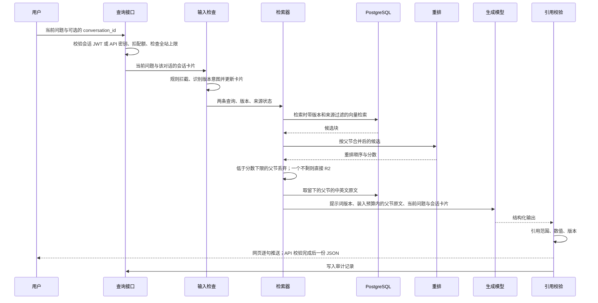

# 07 离线管道与在线时序

对应流程第 7 步「离线管道」和第 8 步「在线路径」。

## 一、离线管道

### 编号规则

| 编号 | 格式 | 例子 | 用途 |
| --- | --- | --- | --- |
| 条目编号 `entry_id` | `{版本}:{类型}:{英文名小写连字符}` | `srd51:spell:fireball` | 一个版本里的一条规则，中英文共用 |
| 概念键 `concept_key` | `{类型}:{英文名小写连字符}` | `spell:fireball` | 关联两个版本的同名条目，供版本对比和版本切换使用 |
| 块编号 `chunk_id` | `{entry_id}#{语言}#{序号}` | `srd51:spell:fireball#en#0` | 只在索引内部使用，不用于标注标准证据 |
| 父节编号 `section_id` | `{entry_id}#{节路径}`；短条目与怪物等于 `entry_id` | `srd51:rule:combat#difficult-terrain` | 同一节的中英文和子块共用。检索去重和交给模型的原文按它取 |

类型取值：`spell`、`monster`、`condition`、`class`、`subclass`、`species`、`race`、`background`、`feat`、`equipment`、`rule`、`glossary`。

### 管道步骤

1. **拉取并固定版本：** 下载 PDF 并计算 SHA-256 校验值；克隆仓库并记录提交号。只接入登记过的版本。
2. **解析：** 按 [06-architecture.md](06-architecture.md) 选型记录四的方式解析。PDF 保留页码，HTML 和 Markdown 保留文件路径和标题锚点。
3. **切成条目：** 一个法术、怪物、状态、专长、背景、物种或种族各算一个条目；职业按「职业」和「子职业」分开；规则章节按小节切分。
4. **中英文对齐：** 每个中文条目要找到对应的英文 `entry_id`，按下面的顺序尝试：
   - 用中文条目标题里自带的英文名匹配：`src-srd52-zh` 的条目标题格式为 `<H4 id="Acid_Splash">酸液飞溅｜Acid Splash</H4>`，一个文件含多个条目，按 `H4` 切分；`src-srd51-zh` 的文件名就是英文条目名，例如 `Spells/Fireball.md`；
   - 用术语表把中文标题译为英文名后匹配；
   - 用文件路径和章节结构匹配；
   - 以上都失败的，记入对齐失败清单，由审核员处理，不入库。
5. **更新术语表：**
   - 从已对齐的 `src-srd52-zh` 条目中抽取中英文术语对。
   - 5.1 独有的术语由模型初译，标记为「待审核」；审核员通过后才用于检索。
6. **分块：** 按下面的「分块」一节执行。超长节才按 token 上限切开，这个上限是实验旋钮，不是目标长度。
7. **嵌入：** 用 `embed_text` 嵌入。英文块和中文块写入同一张表，用「语言」字段区分。更换嵌入模型时不重切，除非分块规则本身改了。
8. **写入新索引版本：** 每次构建都生成一个新的 `index_version`，不修改已发布的版本。
9. **跑验收题：** 达到 [05-acceptance.md](05-acceptance.md) 的门槛后才能发布。
10. **发布：** 把「已发布索引版本」的指针切到新版本。旧版本保留，直到下一次发布成功，以便回退。

### 分块

检索用小块，交给模型的是父节。短条目和怪物的父节就是整条。职业和规则章节的父节是一个二级标题下的那一节；这一节因超过上限被切开时，拼回全部子块，不取整份职业或整章。

**切分：**

| 内容 | 检索块 |
| --- | --- |
| 法术、状态、专长、物品 | 整条一块，`section_id` 等于 `entry_id` |
| 怪物属性块 | 整条一块，不从名字和数值中间切开。表格与表头留在同一块 |
| 职业、子职业、规则章节 | 有二级标题时，每个二级标题为一节。没有二级标题时，整条条目为一节 |
| 一节超过切开上限 | 先按三级标题切，再按段落，最后按句子，直到不超过上限。四级标题留在所属的三级标题里 |

切开上限在实验里只比较 512 和 1024 token。今天不写死其中一个。不加重叠。只有标题、没有正文的标题不入库。

中英文共用 `section_id`，不各自按 token 数决定节的边界。英文先按标题成节；中文用已有锚点或标题对到同一编号。只有某一种语言的那一节超过上限时，才把该语言再切开，子块仍挂在这个 `section_id` 上。拼回父节时按 `chunk_id` 的序号排列。

同一次比较只用一把分词器来数切开上限。分词器名称与块清单校验值写入运行清单。今天不指定是哪一把。换嵌入模型时，只要分块规则和这把分词器没变，就不重切。

**不嵌入：**

- 纯列表和目录：法术列表、怪物数据总表、目录、字母索引。点名查询和筛选留到第二期的结构化查询。
- 法律信息页。页眉、页脚、页码不进正文，页码仍写入 `location`。
- `Monsters (Alt)` 与 `Spells (Alt)`。2026-10-24 核对：它们是主目录的按字母合订，条目标题都能在主目录找到，多出来的只是「怪物（A）」「法术（A）」「红龙」这类分组标题。两套同时入库会重复。只嵌入主目录里一文件一条的版本。

**正文与嵌入文本：**

- `text` 只存这一块的原文。条目路径不写入原文。
- `embed_text` 在原文前加上路径，例如 `Fighter > Champion > Improved Critical`，只用于嵌入。
- 链接只留可见文字，去掉网址和图片路径。
- 切句子时不在 `5.1`、`8d6`、`ft.` 和表格中间断开。

召回仍按权威 `entry_id` 计。生产路径召回不到 90% 时，先检查父节合并和对齐。仍不够，再在 512 和 1024 里换切开上限，并换运行编号。不同时改上限和嵌入模型。

### 不进入生产路径的分块做法

All-in-RAG 第二章把固定大小、递归字符、语义分块和按标题分块都列为可选。本项目只采用按标题成节，超长节再按三级标题、段落、句子切开。下列做法不进入生产路径，也不作为选型实验的对照。若以后要试，先经设计评审，并使用新的运行编号：

- 固定字符块，以及教程示例里的默认重叠。数值、`8d6` 和属性块会被从中间切开，重叠还会让同一证据占两个块。
- 语义分块。切点依赖嵌入模型，模型尚未选定，切点也无法按原文复核。
- 句子窗口。检索单位改成单句之后，交给模型的就不再是完整父节。
- 把假设问题或摘要写进嵌入文本。`embed_text` 只允许路径前缀加原文。

抽查用本节规定的 Chonkie Visualizer。教程里的 ChunkViz 只作演示，不能代替这次抽查。

**抽查：** 用 [Chonkie Visualizer](https://docs.chonkie.ai/oss/utils/visualizer) 把本项目已经切好的块画出来。它不决定边界。分块程序给出每块在原文中的起止位置、token 数和 `section_id`，再交给 Visualizer 导出 HTML。安装 `chonkie[viz]` 即可，不用它自带的切分器。

每种格式抽 20 条。HTML 上核对：切点没有落在句子、`5.1`、`8d6`、`ft.` 或表格中间；怪物属性块和法术头部保持完整；超过切开上限的节是按三级标题、段落、句子切开的；同一 `section_id` 的子块按序号能拼回该父节。Windows 终端可能把中文换成问号，以 HTML 为准。

导出的 HTML 含原文，放在 `E:\ElderBrain\chunk-review\`，不放进选型实验的 `runs/`。ChunkViz、在线分块演示和现成切分器的上色结果不能当作这次抽查。

### 块的元数据

| 字段 | 例子 | 用途 |
| --- | --- | --- |
| `chunk_id` | `srd51:spell:fireball#en#0` | 主键 |
| `entry_id` | `srd51:spell:fireball` | 标准证据、版本与引用 |
| `concept_key` | `spell:fireball` | 版本对比与版本切换 |
| `rule_version` | `5.1` | 检索过滤 |
| `source_id` | `src-srd51-en` | 来源状态过滤、下架 |
| `source_pin` | SHA-256 或提交号 | 追溯 |
| `lang` | `en` 或 `zh` | 展示 |
| `is_authoritative` | `true`（仅英文官方来源） | 冲突时以它为准 |
| `is_machine_translated` | `true`（仅 `src-srd51-zh`） | 展示标注 |
| `section_id` | `srd51:rule:combat#difficult-terrain` | 父节去重，取回中英文原文 |
| `location` | 页码或「文件路径#锚点」 | 引用位置 |
| `entry_title_en`、`entry_title_zh` | `Fireball`、`火球术` | 展示与术语 |
| `index_version` | `idx-2026-10-20-01` | 发布与回退 |
| `entry_path` | `Spells > Fireball` | 引用位置；也是 `embed_text` 的路径前缀 |
| `text` | 这一块的原文 | 拼回父节 |
| `embed_text`、`embedding` | 路径前缀加原文，及其向量 | 检索 |

### 增量更新、删除与重建

- **增量更新：** 第一期不做，任何变更都走整库重建，因为四个来源合计只有一至两万个块。第二期按来源增量更新。
- **整库重建：** 从固定版本的原始文件开始，重跑全部步骤，生成新的 `index_version`。原始文件是事实来源，所以索引任何时候都能按原文重建。
- **删除一个来源：** 按 [02-sources.md](02-sources.md) 的下架流程执行。在线检索立即按来源状态过滤；然后在一个事务里删除该来源的所有块，并清空缓存（第二期起有缓存）。
- **更换嵌入模型：** 必须整库重新嵌入并生成新的索引版本，不能只改查询侧。

## 二、在线时序

### 各步要点

- **问题长度：** 先于配额、嵌入和生成。空问题或超长问题返回 422，不截断，不占每日次数和每分钟次数。审计只记拒绝原因和长度。两道闸见 [03-access-and-threats.md](03-access-and-threats.md)。
- **令牌与配额：** 长度通过之后、检索和模型调用之前执行，失败即返回。网页校验 Cookie 里的会话 JWT，外部调用用 API 密钥。算法、声明、8 小时有效期和登出拒绝名单见 [03-access-and-threats.md](03-access-and-threats.md)。
- **对话：** 按 [04-answer-contract.md](04-answer-contract.md) 读取服务端存档和会话卡片。调用方不提交历史正文。
- **规则拦截：** 第一期用关键词和模式匹配拦截明显的提示注入和现实政治问题，直接返回 R6 或 R8，不调用模型。
- **版本意图：** 按回答契约的关键词表识别，并更新会话卡片。识别为「两版」时进入版本对比分支。识别为切换到另一版时，先按卡片上的 `concept_key` 在目标版本精确取条目，规则见 [04-answer-contract.md](04-answer-contract.md)。
- **查询改写：**
  - 中文提问时，用术语表把术语替换成英文，作为第二条查询；英文提问时反过来。
  - 会话卡片上的条目标题参与查询。精确命中的 `concept_key` 不再参与这两条查询。第一期不额外调用模型做改写。
- **检索与重排：** 顺序固定。版本切换时，精确命中的条目直接进入本次检索结果，不进入下面的向量检索和重排。没有命中的键才走下列步骤，查询文本用该条目的标题加上当前问题，并过滤到目标版本。
  1. 两条查询各自做向量检索。`rule_version` 和 `source_status = active` 在检索时过滤，不在取完固定前 k 名之后再滤。
  2. 候选数量是实验旋钮，起点为每条查询 20 条，今天不写死。
  3. 两路结果按父节合并。
  4. 对合并后的候选做重排。每个父节用分最高的那一块代表。
  5. 重排分低于该模型下限的父节不送进生成。一个都不剩，就直接按 R2 返回，不调用生成模型。下限在选型实验里标定，约束是生产路径、前 5 条、题目级召回仍 ≥ 90%。换嵌入模型或重排模型时重标。
- **装入生成上下文：** 按重排顺序装入父节的中英文原文，不摘要。短条目和怪物的父节是整条；长条目的父节是命中块所在的那一节，被切开的子块按序号拼回。装入预算是实验旋钮，起点约为 2.5k token 的父节正文，并记录装入了几节。版本对比的两侧共用这一预算。今天不写死节数或 4000 token。同一次比较用同一把分词器，名称写入运行清单，今天不指定是哪一把。费用仍按厂商返回的 token 数记。
- **版本对比分支：** 对 5.1 和 5.2 各走一遍上述检索和重排，再按 `concept_key` 配对，交给模型分版本作答。两侧共用同一个装入预算。
- **生成：** 提示词版本号从版本登记中读取。模型输出固定的结构：
  - 类型：回答或拒答；
  - 拒答类别；
  - 句子列表，每句带引用的 `entry_id`。
  
  R3、R5、R7 以及模型无法回答的 R1、R2，都由模型在这一步给出。
- **引用校验：**
  - 每句的引用都必须在本次检索结果里；
  - 句中出现的骰子表达式和数字必须能在本次交给模型的该父节英文原文里找到；
  - 回答标注的版本必须与引用条目的 `rule_version` 一致。
  
  校验失败时重新生成一次，仍然失败就按 R2「证据不足」返回。
- **返回：** 网页在版本标注之后逐句校验、逐句推送。首字响应时间按第一句通过校验的规则结论计算。查询 API 在全部校验完成后一次返回 JSON，不流式。字段包括 `conversation_id`、版本标注、带 `entry_id` 的句子、引用列表，以及拒答时的类别。API 的时间看完整回答，P95 ≤ 15 秒。

### 失败时的返回

| 情况 | HTTP 状态 | 返回给用户 | 记录 |
| --- | --- | --- | --- |
| 会话 JWT 或 API 密钥无效 | 401 | 请重新登录，或检查密钥 | 审计 |
| 配额耗尽、达到全站上限 | 429 | 今日次数已用完，或服务今日已达上限，并给出恢复时间 | 审计、计数 |
| 角色不足，或对话不属于当前用户 | 403 | 无权限 | 审计 |
| 空问题、超长问题或版本取值非法 | 422 | 具体哪个参数不合法；长度问题说明是哪一道闸 | 审计只记原因和长度，不占配额 |
| 规则拦截（R6、R8） | 200 | 对应拒答文案 | 审计 |
| 检索超时（超过 3 秒） | 504 | 检索超时，请稍后重试；不计入配额 | 告警计数 |
| 无证据或证据不足（含重排后没有父节达到分数下限） | 200 | R2 文案与最接近的条目链接 | 审计、审核队列 |
| 模型调用失败或超时 | 503 | 生成服务暂时不可用，请稍后重试；不计入配额。第三期起改用备用模型 | 告警计数 |
| 引用校验两次失败 | 200 | 按 R2 返回 | 审计、审核队列 |

### 短路径与长路径的分流条件

第一期只有短路径。从第二期起，满足以下任一条件的问题标记为「长路径候选」。长路径上线之前，这些问题仍走短路径，并在回答末尾注明完整裁定需要 DM 判断：

- 送进模型的父节涉及 3 个及以上不同类型的条目，例如状态、法术、战斗规则同时出现。
- 问题里同时出现两个及以上规则对象，并带有「同时」「叠加」「能否」「如果……会怎样」之类的表述。
