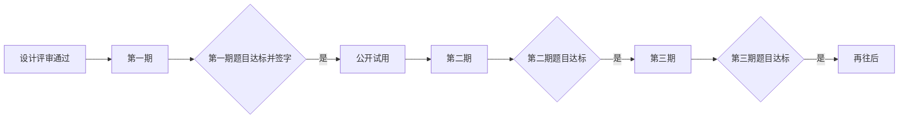

# 09 分期计划

对应流程第 10 步「分期」。每一期都要能单独验收：通过本期列出的题目，并由项目作者签字。

## 与流程模板的差异

2026-11-03 起，第一期与流程模板一致：只接一个来源，即中文 SRD 5.1。英文规则书、中文 5.2 和版本对比不再进入第一期。

## 第一期：可公开试用的最小版本

**范围：**

- 来源：只入库 `src-srd51-zh`，固定提交号，整库重建。
- 场景：定点查询、规则机制解释。问到 5.2 或两版差异时拒答。
- 检索：向量检索，检索时过滤版本和来源；一条中文查询；合并后重排；重排分下限。父节装入量和切开上限由实验选定，不预设 token 数。
- 回答：版本标注、逐句引用、引用校验、八类拒答与澄清。服务端保存多条对话和会话卡片。网页逐句推送；查询 API 校验完成后一次返回 JSON。
- 账号：GitHub 与邮箱登录。网页会话是 8 小时的 HS256 JWT，放在 HttpOnly Cookie 中；登出把 `jti` 写入拒绝名单。管理员只来自环境变量名单。网页上创建可吊销的 API 密钥，每用户同时最多 2 把。网页和 API 共用每账号每日配额、每分钟配额和全站每日成本上限。新账号首日低配额。空问题和超长问题不占配额。
- 安全：基本的输入检查（注入、现实政治的规则拦截），输出按纯文本或消毒后的 Markdown 渲染。
- 运行：审计记录（字段见 [08-operations.md](08-operations.md)）、日志脱敏、邮件告警、手动发布与回退、手动下架流程。
- 管理：管理端可以停用来源、重建索引、切换已发布版本、查看审核队列列表。

**依赖：**

- `src-srd51-zh` 的固定提交号和署名文本已经确认；
- 嵌入模型和生成模型完成对比，见 [06-architecture.md](06-architecture.md) 的选型记录二、三；
- 验收题经项目作者审核，标准证据补全页码和锚点。

**必须通过的题目：** [05-acceptance.md](05-acceptance.md) 里语言为中文、版本为 5.1 的 L、M、R。C 类、V 类、英文题和 5.2 题不计入。P 类题不计。门槛：

- 检索召回率 ≥ 90%
- 引用支持率 ≥ 95%
- 正确拒答率 ≥ 95%
- 版本混淆为 0

## 第二期：检索质量与运营闭环

**范围：**

- 混合检索：用验收题对比 PostgreSQL 中文分词扩展和 Qdrant 稀疏向量两条路线，选召回更高的一条。融合方式另开一轮，只比倒数排名融合和加权打分。重排已在第一期，第二期不重复引入。多查询、假设性文档嵌入、退步提示和上下文压缩仍不引入。
- 缓存：缓存键包含规则版本、索引版本、提示词版本和来源状态版本；下架时清空。
- 发布门禁：验收题自动运行，不达标则禁止发布；保留一键回退。
- 增量同步：按来源增量更新；自动检查 `src-srd51-zh` 上游仓库的变化。
- 条件筛选：从条目中抽取结构化表，例如法术的环阶、学派、职业，怪物的 CR、类型，武器的属性。模型只填这些白名单字段，由代码生成参数化 SQL。模型写出的 SQL 文本不执行。
- 审核员角色与独立的审核队列页面；日志查询按审核队列关联关系过滤。
- 长路径候选的标记（分流条件见 [07-pipelines.md](07-pipelines.md)）。

**依赖：** 第一期上线并稳定运行；有至少一个月的线上问题用于修正问题类型分布。

**必须通过的题目：**

- 第一期计入分母的题目，门槛不降低；
- 加上 P01、P02、P03 三道条件筛选题；
- 加上从第一期线上问题中新增的验收题。题目集升级为 `eval-v1.x`。

## 第三期：完整体验与稳定性

**范围：**

- 角色创建与升级指引（按章节顺序组织多条检索结果）。
- 完整护栏：模型级的输入和输出检查，覆盖更多注入变体。
- 成本预算告警细化：按模型、按场景统计成本。
- 备用模型：自动切换条件见 [08-operations.md](08-operations.md)。
- 线上抽样评估：每周自动打分加人工复核。

**依赖：** 第二期的发布门禁与审核队列已经运行。

**必须通过的题目：**

- 第二期的全部题目；
- 加上 P04、P05；
- 加上备用模型单独跑一遍全部题目，同样达到门槛。

## 再往后

- 规则交互裁定：长路径，多步检索。必须通过 P06、P07、P08，以及新增的交互类题目。
- 图索引：在规则条目之间建立「引用、修改、依赖」关系，作为第二条索引并行检索。
- 长路径可以用查询分解做多步检索。每一步仍读已发布索引。检索轮次不交给模型自行决定，检索失败时拒答，不改去网页搜索。
- 更细的文档解析：表格、怪物属性块的字段级结构化。

## 交付顺序

